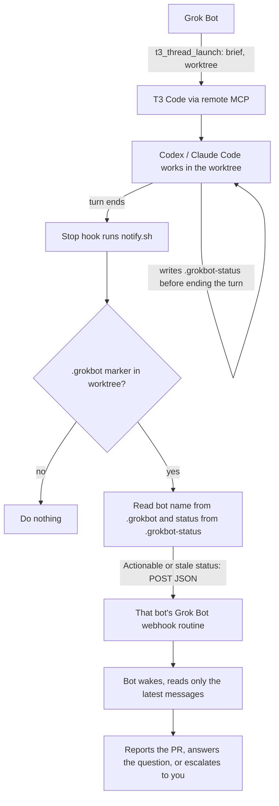

# grokbot-t3-bridge

Connect Grok Bot agents to plain Claude Code, plain Codex CLI, or [T3 Code](https://t3.codes) ([source](https://github.com/pingdotgg/t3code)) and get woken up when a coding thread finishes, instead of polling it.

T3 Code is a desktop app that runs coding agents such as Codex and Claude Code in threads, each in its own git worktree. Grok Bot can drive it through T3's remote MCP connector: list projects, launch a thread with a brief, read it, reply to it. This repo covers that setup, plus a small hook that tells the right bot when a coding turn ends.

## Choose your harness

Which harness do you use? Follow one path:

- **[T3 Code](docs/t3.md):** start, track, read, and nudge threads through T3 MCP.
- **[Plain Claude Code](docs/claude-code.md):** start with `claude` or `claude -p`;
  track the session ID and transcript path; continue with `claude -p --resume`.
- **[Plain Codex CLI](docs/codex-cli.md):** start with `codex` or `codex exec`;
  track the session ID; continue with `codex exec resume`.

All paths use the same `notify.sh`, marker, status words, and webhook setup.
For plain CLI use, the bot needs shell access to the agent machine to read local
history or resume a stopped session. Without it, the bot can only notify you.
This bridge cannot steer a live interactive CLI or approve tools. Read each
file before installation. The one-shot prompt asks which path to build and
requires your approval of the files before it installs them.

The quickstart and T3 workflow below are for **T3 Code**. Plain CLI users should
follow their linked guide and [shared CLI setup](docs/cli-setup.md).

## Don't want to run our scripts? Have your bot build it

You don't have to trust the code in this repo. [ONE-SHOT-PROMPT.md](ONE-SHOT-PROMPT.md) is a single prompt you can paste into your own Grok Bot, or any agent with shell access to your agent machine. It describes the whole setup as a spec, so your agent writes its own version, shows you every file before installing, and leaves the secrets for you to enter yourself.

## The problem

Without a callback, a bot that launches a T3 thread has no way to know when the work is done. In practice ours ended up waiting on threads in 10-minute stretches and re-reading the thread activity each time. That burned tokens on reading the same messages over and over, and it still missed stalls: a thread that stopped to ask a question could sit for a long time before anyone noticed.

## The solution

Coding harnesses have a `Stop` hook that runs every time the agent ends a turn. We point it at one script, `notify.sh`. If the worktree was launched by a bot, the script POSTs a short JSON payload to that bot's Grok Bot webhook routine. The bot wakes up, reads only the latest messages, and acts: sends the PR link, answers a question, or escalates to you.



## T3 Code quickstart

You need macOS or Linux with `bash`, `jq`, `git`, `perl`, `shasum` and `curl` on the machine where T3 Code runs.

1. **Connect T3 Code to Grok Bot.** Turn on T3 Connect remote access in T3 Code, then add T3's remote MCP as a connector in Grok Bot and authorize it with OAuth. Details: [docs/t3-mcp-setup.md](docs/t3-mcp-setup.md).

2. **Install the hook** on the machine that runs T3 Code:

   ```bash
   git clone https://github.com/DoubleDipCode/grokbot-t3-bridge.git
   cd grokbot-t3-bridge
   ./install.sh
   ```

   This copies the scripts to `~/.grokbot-hooks` and adds a `Stop` entry to `~/.codex/hooks.json` and, if Claude Code is set up, `~/.claude/settings.json`. Running it again changes nothing.

3. **Trust the hook in Codex.** Run `codex`, type `/hooks`, and trust the "Notifying Grok Bot" hook. Claude Code has no trust step. See [docs/hooks.md](docs/hooks.md).

4. **Create a webhook routine per bot** in Grok Bot, named "T3 callback", using [templates/routine-prompt.md](templates/routine-prompt.md) as its prompt. Copy its URL and Authorization header from the routine panel. See [docs/grokbot-side.md](docs/grokbot-side.md).

5. **Store each bot's webhook** on the Mac (or Linux machine):

   ```bash
   ~/.grokbot-hooks/set-webhook.sh codexbot
   ```

   It asks for the URL and then the Authorization header value with hidden input, and writes `~/.grokbot-hooks/codexbot.env` with mode 600. Bot names are lowercase letters, digits, `-` and `_`.

6. **Add the brief footer** from [templates/brief-footer.md](templates/brief-footer.md) to every brief the bot sends to T3. It tells the coding agent to write the `.grokbot` marker and a `.grokbot-status` file.

7. **Test it.** Have the bot launch a small thread, then watch `~/.grokbot-hooks/notify.log`. You should see a `status=` line followed by `webhook http=200`.

To remove the hook entries later, run `./uninstall.sh`.

## What's in here

```
README.md                 this file
ONE-SHOT-PROMPT.md        paste-in prompt for building your own version from scratch
install.sh                installs the hook for Codex and Claude Code (idempotent)
uninstall.sh              removes the hook entries again
hooks/notify.sh           the Stop hook: reads marker + status, POSTs to the bot
hooks/set-webhook.sh      stores one bot's webhook URL + auth in a chmod 600 file
docs/t3-mcp-setup.md      connecting T3 Code's MCP to Grok Bot, and the tools bots use
docs/hooks.md             hook config per harness, payload schema, debugging
docs/t3.md                T3 path and existing workflow links
docs/claude-code.md       plain Claude Code setup and resume
docs/codex-cli.md         plain Codex CLI setup and resume
docs/cli-setup.md         shared setup and limits for plain CLI sessions
templates/cli-*.md        plain CLI task footer and callback routine
docs/grokbot-side.md      webhook routine, brief additions, backup check, cleanup
templates/routine-prompt.md   prompt for the "T3 callback" routine
templates/brief-footer.md     text to append to every brief sent to T3
```

## Actionable status and stall checks

The first word of `.grokbot-status` controls delivery:

| Word | Action |
| --- | --- |
| `waiting <what>` | Skip. The thread must have its own timer or webhook. |
| `idle` | Send. |
| `needs_input`, `failed` | Always send, even when repeated. |
| `milestone <what>`, `done ...` | Send. |
| Any other word | Send for compatibility. This includes `continuing`, `turn_ended_no_status`, and `worktree_missing`. |

Except for `needs_input` and `failed`, a status identical to the last successful
send is skipped. The comparison uses the payload status (up to 2000 bytes),
including trailing newlines. State is stored per worktree in
`~/.grokbot-hooks/state/`. Only an HTTP 2xx response updates the sent status and
clock. Failed requests can be sent again on a later invocation. Skips are logged
as `skip=waiting` or `skip=duplicate` in `notify.log`.

A waiting worktree gets a `stale waiting ...` notification after 7200 seconds
since its last successful ping. If it has never sent a ping, the first observed
waiting status starts the clock. A successful stale ping resets the clock; it
can recur after another interval. Stale reminders bypass dedupe.

Every hook invocation starts a background sweep of known waiting worktrees and
missing markers. The current worktree is handled once. `notify.sh --sweep`
runs the same check in the foreground without reading stdin, so launchd waits
for completion. Stop-hook checks remain detached. A sweep reads the current marker
and status files. It does not replay completed work. No check can run while the
machine is off.

For checks when there are no Stop events, an optional launchd example runs every
15 minutes. It is not installed automatically. From this checkout, run these
commands only when you choose to deploy:

```bash
cp "$HOME/.grokbot-hooks/notify.sh" "$HOME/.grokbot-hooks/notify.sh.backup-$(date +%Y%m%d-%H%M%S)"
cp hooks/notify.sh "$HOME/.grokbot-hooks/notify.sh"
chmod 700 "$HOME/.grokbot-hooks/notify.sh"
# Optional periodic sweep:
mkdir -p "$HOME/Library/LaunchAgents"
sed "s|/Users/REPLACE_ME|$HOME|g" examples/com.grokbot.notify-sweep.plist > "$HOME/Library/LaunchAgents/com.grokbot.notify-sweep.plist"
launchctl load "$HOME/Library/LaunchAgents/com.grokbot.notify-sweep.plist"
```

The plist sets PATH for Homebrew tools. Check its absolute script path before
loading it. To change the interval, edit `StartInterval` (seconds).
`GROKBOT_STALE_SECONDS` sets the stale threshold (default `7200`).
`GROKBOT_HOOKS_DIR` overrides the hooks directory; `GROKBOT_STATE_DIR` overrides
only the state directory. Set these in the launchd environment too if needed.

Run `python3 tests/notify-http-test.py` for local HTTP payload tests for all three paths.
Run `bash tests/notify-test.sh` for isolated tests with a stub curl. The tests
use temporary HOME, hooks, and state directories and make no real HTTP requests.

## Design decisions

**Harness-agnostic.** There is one script. Each harness gets one config line that calls it with its own name (`notify.sh codex`, `notify.sh claude`). Adding another harness that has a turn-end hook means adding one more line, not another script.

**Opt-in per worktree.** The script does nothing unless the worktree root contains a `.grokbot` file. Bots write that file as the first step of a brief. Your own Codex or Claude Code sessions never have it, so they never trigger anything. The marker is excluded through the repo's `info/exclude`, so it never shows up in `git status` or gets committed.

**The agent writes its status to a file.** Before ending each turn the agent overwrites `.grokbot-status` with a status word and a short note. The script reads that file. It does not parse harness transcripts, which differ between harnesses and change between versions.

**It survives a removed or switched worktree.** Every run that finds a marker records the worktree and bot in `~/.grokbot-hooks/markers.tsv`. If a later turn ends in a known worktree whose marker is gone, the bot is still notified, with the status `worktree_missing`. Runs with no marker and no record are always logged as `no-marker <path>`, so a missed callback shows up in the log instead of failing silently.

**The hook fires whether or not the agent remembers.** The hook is run by the harness, not by the agent. If the agent forgets to write a status, the payload says `turn_ended_no_status` and the bot reads the thread to find out what happened. You still get woken up.

**One webhook and one key per bot.** Each bot has its own routine, URL and key, stored in its own `~/.grokbot-hooks/<bot>.env`. The marker names the bot, so the callback goes to the bot that launched the thread and no other.

**Secrets stay in files on the machine.** Webhook URLs and keys live only in chmod 600 files under a chmod 700 directory, entered through a hidden prompt. They never go into briefs, prompts, chat or logs. The log records the HTTP status code only.

**A quiet backup check.** If a turn never ends, because the harness crashed or the machine went offline, no hook fires. Each bot keeps a low-frequency backup check (for example every hour or two) that looks at its open threads and stays silent unless something is stuck.

**One thread per task, and threads don't delete their own worktree.** A harness session keeps the working directory it started in. If you reuse a thread for a new task in a new worktree, its turns still end in the old path, so the hook looks for the marker in the wrong place. And a thread that runs `git worktree remove` on its own worktree deletes the marker before its turn ends. The bot removes the worktree after the thread's final turn instead. See [docs/grokbot-side.md](docs/grokbot-side.md).

**Use full-access threads for bot work.** A thread in approval-required mode that stops on a permission prompt has not ended its turn, so the hook does not fire and the bot cannot approve the prompt either. Bots should launch full-access threads in a worktree. If a thread must be approval-required, a human has to watch it in T3.

## Limits

- The hook only tells you that a turn ended. Everything else comes from reading the thread through the MCP.
- `last_message` uses `last_assistant_message` when supplied by either harness.
- `session_id`, `transcript_path`, and `cwd` come from Stop input. They are empty
  for sweeps; see [the payload schema](docs/hooks.md#payload).
- `worktree_missing` only works for worktrees the hook has seen with a marker at least once. A worktree removed before its first turn ended is reported as `no-marker`, and only the backup check finds it.
- `notify.log` now gets a `no-marker` line for every turn of your own sessions too. It is rotated once at about 1 MB (`notify.log.1`), so it stays small.
- The script sends the callback in the background and does not retry. If the POST fails, `notify.log` shows `http=000` or the error code, and the backup check catches the thread later.

## License

MIT. See [LICENSE](LICENSE).
